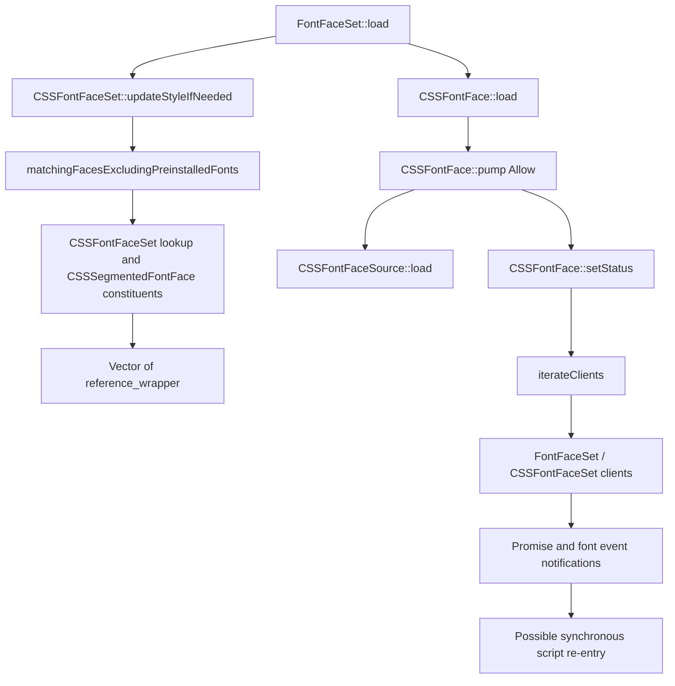

# FontFace Call Graph in the Archived WebKit Sources

**Source examined:** the archived Nintendo WebKit source tree, labelled 3.12.11 and containing embedded WebKit version 613.3.9. The line references below refer to files in that source tree.

1. `FontFaceSet::load` updates style, asks its backing `CSSFontFaceSet` for matching faces, calls `load()` on each, checks for failure, then obtains wrappers and records pending promises (`WebCore/css/FontFaceSet.cpp:150–189`).
2. `CSSFontFaceSet::matchingFacesExcludingPreinstalledFonts` parses the shorthand, walks code points and family order, collects constituent `CSSFontFace*` values, then returns `Vector<std::reference_wrapper<CSSFontFace>>` (`WebCore/css/CSSFontFaceSet.cpp:384–435`; declaration in `CSSFontFaceSet.h:85`).
3. Each `CSSFontFace::load()` enters `pump(Allow)` (`WebCore/css/CSSFontFace.cpp:628–631`). `pump` may synchronously call the source loader for local sources and may transition status (`CSSFontFace.cpp:571–625`).
4. In this source revision, `setStatus` calls client callbacks before assigning `m_status` (`CSSFontFace.cpp:498–523`). Callbacks may update font-set state or notify promise/event clients. This ordering matches the target of upstream bug 322233.

The archived code establishes an opportunity for synchronous callbacks in `pump` and `setStatus`. By itself, it does not establish which JavaScript operation runs in the Switch applet or that returned raw references become invalid in an observed run.
