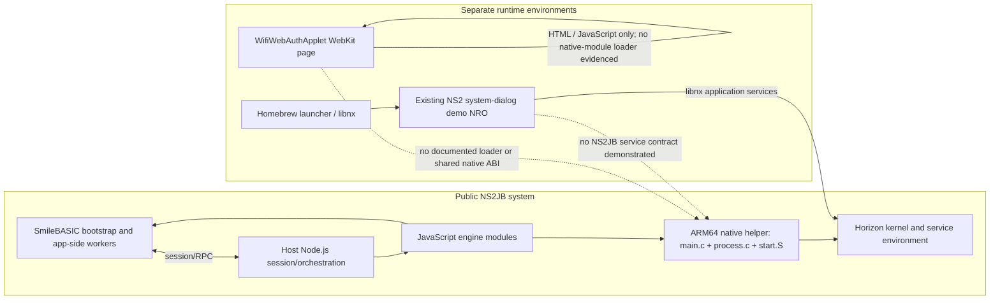

# Dependency graph (architectural only)

The graph is based on upstream source roles, not a runtime trace. The privileged payload's operation-level IPC and process-control edges are intentionally abstracted.

## Evidence notes

- The upstream README distinguishes the SmileBASIC bootstrap, host Node entrypoint, engine, and native helper, and names Zig 0.15.2 as the advertised payload build toolchain.
- Upstream `main.c` and `start.S` are Horizon/AArch64-specific. `process.c` belongs to a privileged process-control boundary. This graph deliberately does not expand its request formats or operations.
- The local NRO README/build record describes a standalone libnx homebrew program. Its NRO header is confirmed locally; console launch is not.
- Dashed edges are **not supported by evidence** and are shown to make the missing integration boundary explicit.

Sources: [NS2JB README](https://gitlab.com/pepsipu/ns2jb/-/blob/95f5525089273c5fce0b95047f3600f8442e96ae/README.md), [payload sources](https://gitlab.com/pepsipu/ns2jb/-/tree/95f5525089273c5fce0b95047f3600f8442e96ae/engine/switch2/ro/payload), [local NRO record](../native-demo/README.md).
